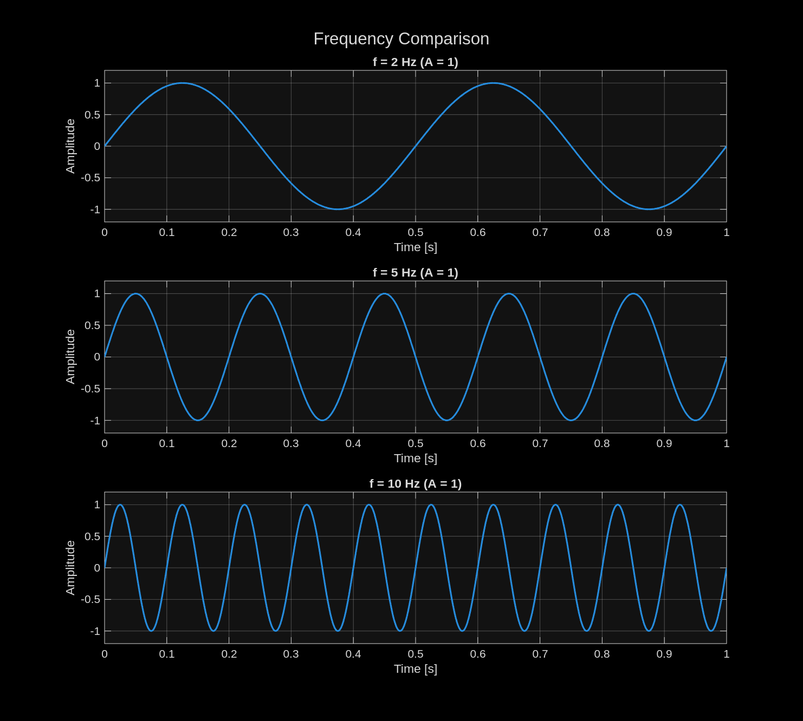
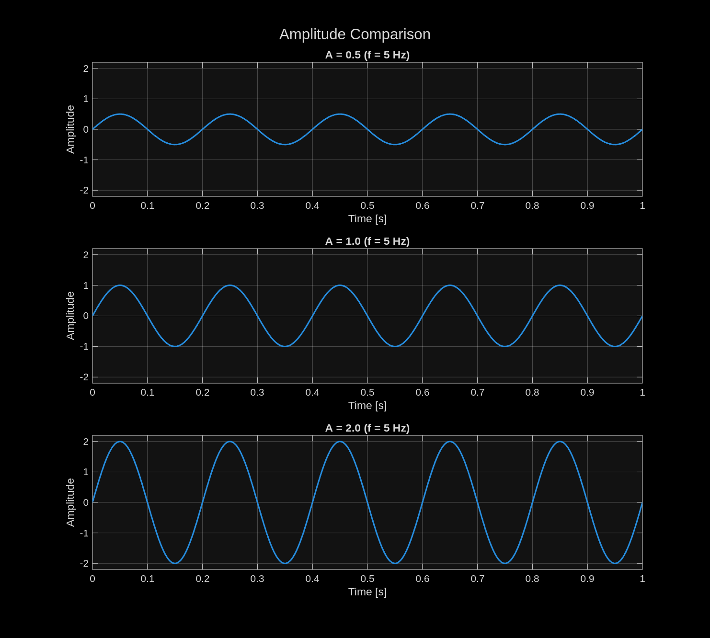
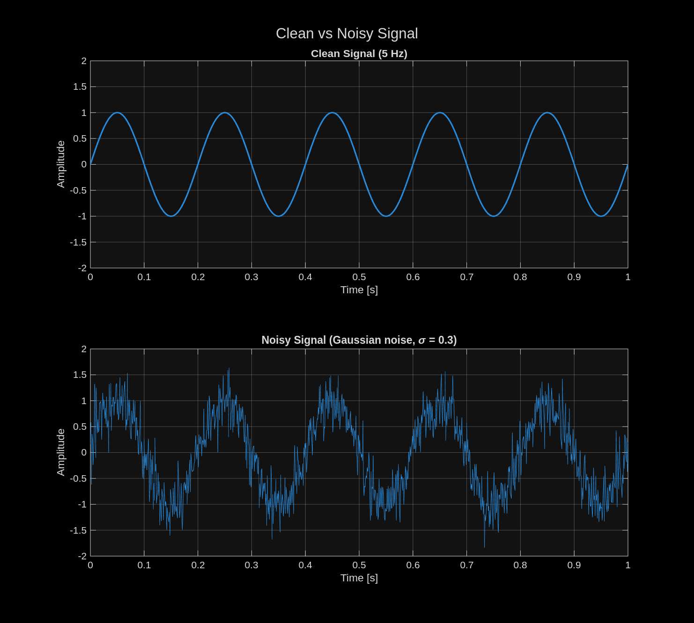

## Task 1: Sine wave

A 5 Hz sinewave with amplitude 1 over 1 second. Five 0.2s periods visible in plot.

## Task 2: Different frequencies

1. **Which signal changes fastest?** The 10 Hz signal. It completes 10 cycles per second, so its value rises and falls more quickly than 2 Hz or 5 Hz.
2. **Which signal has the lowest frequency?** The 2 Hz signal.
3. **How can you see the difference in the plots?** By counting the cycles. Higher frequency means the peaks are closer together. Amplitude is the same so all waves have same height.

## Task 3: Different amplitudes

All three signals are 5 Hz. The y-axis is fixed to the same range on every subplot so the heights can be compared directly.

1. **Which signal has the largest amplitude?** The signal with A = 2; it swings between −2 and +2.
2. **Does changing amplitude change frequency?** No. All three still show exactly 5 cycles per second and the peaks line up in time. Amplitude only scales the signal vertically.
3. **Real-world example where amplitude matters:** In audio amplitude corresponds to loudness of the sound.

## Task 4: Adding noise

White noise with standard deviation 0.3, generated with `randn`. `rng(0)` is used so the result is the same on every run.

1. **What changed after adding noise?** The smooth curve became noisy. Each sample is randomly shifted up or down, so the waveform is no longer a clean sine.
2. **Can you still recognize the original signal?** Yes. The 5 Hz oscillation and five cycles are still visible because the noise is small compared to the signal amplitude. With much stronger noise the sine would become hard to see by eye.
3. **Real-world source of noise:** Electromagnetic interference, for example switching noise from motor drivers coupling into sensor wires.

AI Tool Used: Claude Opus 5

 Prompt: Copy pasted tasks 1 to 4.

 What AI Suggested: Quite the same as matlab's autocomplete suggested, with some different variable names and values.

 Did the code work immediately?: Yes.

 What did you modify?: Removed unnecessary lines to keep it simple and efficient.

 How did you verify the result?: By reading the code and looking at the plots.

